# Implementation Plan: Instalação e configuração (install-and-setup)

**Branch**: `spec/002-install-and-setup` | **Date**: 2026-11-07 | **Spec**: [spec.md](spec.md)

**Input**: Feature specification from `specs/002-install-and-setup/spec.md`

## Summary

O IdleOn Companion vira um app instalável: um instalador NSIS por usuário (electron-builder) põe um único executável
em `%LOCALAPPDATA%\Programs\IdleOn Companion\`, que faz os dois papéis — com `--keeper` é o guardião que a Steam lança
direto (sem `.cmd`, o que devolve o overlay e a compra de gemas), sem argumento é o app. Enquanto a Steam não está
configurada, a janela do app é uma tela só que fecha a Steam, acrescenta a parte do companion à opção de inicialização
do jogo no `localconfig.vdf` (sem apagar nada do usuário, com cópia) e reabre a Steam; "Remove from Steam" e o
desinstalador tiram só essa parte. "Let the game close" faz o guardião desanexar da página (o X do jogo volta a fechar),
e "Reconnect" pega o motor de novo com uma pausa. O app procura versões no repositório público de releases
(electron-updater, hash conferido) e nunca instala com o jogo aberto. Decisões em [research.md](research.md).

## Technical Context

**Language/Version**: TypeScript 6 (nodenext, strict, exactOptionalPropertyTypes), Node do Electron 45.2.3

**Primary Dependencies**: Electron 45.2.3, electron-vite 6.0.0, React 19.3.1 (já no projeto); **novas**:
electron-builder 26.18.0 (dev) e electron-updater 6.8.11 (runtime) — ambas MIT, ativas; aprovadas pelo Vinicius em
07/11 (AGENTS.md: perguntar antes de adicionar dependência).

**Storage**: arquivos em `%APPDATA%\IdleOn Companion\` (os da 001, mais `steam-setup.json` e `steam-backup\`); o
`localconfig.vdf` da Steam, só no trecho da opção do jogo.

**Testing**: vitest 5 + jsdom + @testing-library/react (`just check`); roteiro manual no [quickstart.md](quickstart.md)
para instalador, desinstalador, Steam e atualização reais.

**Target Platform**: Windows 10/11 com a Steam; Legends of Idleon (appid 1476970).

**Project Type**: app de desktop (Electron), dois processos (guardião e app) num executável só.

**Performance Goals**: pausa do jogo em "Reconnect" igual à da 001 (~300 ms, uma vez); painel de volta em ≤ 2 s (SC-004);
X fecha em ≤ 2 s depois de "Let the game close" (SC-003).

**Constraints**: só leitura dentro do jogo; nenhuma mudança na Steam sem clique; nunca gravar com a Steam aberta nem
matar o processo dela; nunca instalar atualização com o jogo aberto; rede só no atualizador do app (constituição
1.1.0); nenhum arquivo do jogo no instalador; nada de `.cmd` entre a Steam e o jogo.

**Scale/Scope**: o Vinicius e alguns amigos; uma conta Steam por vez na tela, várias contas configuradas guardadas.

## Constitution Check

*GATE: Must pass before Phase 0 research. Re-check after Phase 1 design.*

| Princípio | Como o plano cumpre | Antes | Depois do desenho |
| --- | --- | --- | --- |
| Missão e não-objetivos | Só leitura no jogo (R7 reaproveita o leitor da 001); rede só no atualizador do app, por HTTPS e com hash (emenda 1.1.0, R3); nenhum arquivo do jogo no pacote (R2) | ok | ok |
| TDD e `just check` | Cada tarefa de código começa pelo teste que falha; testes sem rede e sem Steam real (R10) | ok | ok |
| Simplicidade | Leitor de VDF próprio e pequeno em vez de dependência que reescreve o arquivo (R4); nenhuma opção nova além das da spec | ok | ok |
| Arquitetura | Nova fronteira (`src/start/`) vira regra do dependency-cruiser e entra no `ARCHITECTURE.md`; integração com a Steam e com o GitHub de releases também | ok | ok |
| Código | Arquivos ≤ 400 linhas (o `keeper.test.ts` de 463 linhas não cresce: os testes novos do guardião vão num arquivo próprio); nomes em inglês; logs com rótulo e id | ok | ok |
| Segurança | Nenhum segredo no código (o token da release fica no terminal do Vinicius, R8); entradas de fora validadas (payloads do IPC e do elo, o VDF lido); menor privilégio (instalação por usuário, sem administrador) | ok | ok |
| Dependências | electron-builder e electron-updater: MIT, ativas, sem regressão aberta conhecida para Electron 45 no NSIS por usuário; aprovadas pelo Vinicius (07/11) | ok | ok |
| Specs | A spec congela no merge do PR da spec; o `ARCHITECTURE.md`, o `GLOSSARY.md` e os ADRs passam a dizer a verdade nova | ok | ok |

Sem violações: a tabela Complexity Tracking não se aplica.

## Project Structure

### Documentation (this feature)

```text
specs/002-install-and-setup/
├── spec.md
├── plan.md              # este arquivo
├── research.md          # Fase 0
├── data-model.md        # Fase 1
├── quickstart.md        # Fase 1 (roteiro manual com a Steam e o instalador)
├── contracts/
│   ├── link.md          # mensagens novas do elo e o status "released"
│   ├── ipc.md           # canais novos entre a janela e o app
│   └── command-line.md  # --keeper, --remove-from-steam e a opção da Steam
├── checklists/          # requirements, security, ux
├── diagramas/           # arquitetura antes/depois, sequência, ciclo de vida
└── tasks.md             # /speckit-tasks
```

### Source Code (repository root)

```text
src/
├── start/
│   └── index.ts             # NOVO: despacha por argv para o guardião, o desinstalador ou o app
├── keeper/
│   ├── index.ts             # muda: argumentos depois de --keeper, caminhos do app e do read.js empacotados
│   ├── keeper.ts            # muda: release/reconnect pelo elo, status "released"
│   ├── reader.ts            # muda: stop() espera a soltura
│   ├── link-server.ts       # muda: entrega release/reconnect
│   └── keeper-release.test.ts  # NOVO: soltar e reanexar com o Cdp falso
├── main/
│   ├── index.ts             # muda: tela de configuração, IPC novos, bandeja dinâmica, atualizador
│   ├── steam/               # NOVO (processo principal, Node)
│   │   ├── vdf.ts           # leitor de KeyValues com posições, troca de trecho
│   │   ├── launch-option.ts # acrescentar/tirar a parte do companion, aviso de console
│   │   ├── locate.ts        # pasta da Steam, conta mais recente, jogo instalado, localconfig da conta
│   │   ├── setup.ts         # fluxo: fechar a Steam, cópia, gravar, reabrir (operações de sistema injetadas)
│   │   └── index.ts         # API pública do módulo
│   ├── updates.ts           # NOVO: electron-updater e a decisão de instalar (pura, testada)
│   ├── remove-from-steam.ts # NOVO: modo --remove-from-steam do desinstalador (códigos de saída)
│   ├── payloads.ts          # muda: formatos dos IPC novos
│   └── setup-store.ts       # NOVO: steam-setup.json (contas configuradas, texto inserido, cópia)
├── preload/index.ts         # muda: API nova em window.companion
├── renderer/
│   ├── App.tsx              # muda: sem configuração → só SetupView
│   ├── SetupView.tsx        # NOVO: a tela única de configuração
│   ├── StatusBar.tsx        # muda: Let the game close / Reconnect, lembrete do X, Update ready
│   └── SettingsView.tsx     # muda: Set up Steam, Remove from Steam, linha de atualização
└── shared/
    ├── types.ts             # muda: Status.reader "released", SteamState, UpdateState
    └── link.ts              # muda: mensagens release/reconnect

build/installer.nsh          # NOVO: customUnInit do desinstalador
electron-builder.yml         # NOVO: NSIS por usuário, extraResources read.js, publish no repo de releases
scripts/steam-launch.cmd     # SAI
docs/steam-setup.md          # reescrito: instalador, tela de configuração, SmartScreen, desfazer
```

**Structure Decision**: a 001 continua (guardião, elo, app). A entrada nova `src/start/` só despacha e importa só os
pontos de entrada do guardião, do app e do modo do desinstalador. O módulo da Steam fica no processo principal do app
(`src/main/steam/`), porque só o app mexe na Steam; o guardião não ganha nada da Steam. As partes puras (VDF, opção,
decisão de atualizar) não importam `electron` nem `child_process`, para os testes.

### Fases sugeridas para o `/speckit-tasks`

Pela lição 5 da 001 (fases pelo tamanho, não só pelo tema):

1. **Done gate** `[sessão]`: regra `start-only-dispatches` no `.dependency-cruiser.cjs`; receita `just release`
   (R8) e `just package` (build + `electron-builder --win nsis` sem publicar) no `justfile`; ignorar `dist/` onde o
   lint e o gitleaks olham.
2. **Um executável** (US1, parte 1): `src/start/`, guardião com argumentos depois de `--keeper` e caminhos empacotados,
   `electron-builder.yml`, saída do `steam-launch.cmd`. Pronto quando `just package` gera o instalador e a Steam,
   apontada à mão para o exe instalado, abre o jogo lendo (quickstart §2).
3. **Steam: ler e gravar** (US1, parte 2): `vdf.ts`, `launch-option.ts`, `locate.ts`, `setup-store.ts`, com testes.
4. **Steam: fluxo e tela** (US1, parte 3): `setup.ts`, IPC novos, `SetupView`, App sem configuração → só a tela.
5. **Deixar o jogo fechar** (US2): elo, guardião, leitor, barra, bandeja.
6. **Desfazer** (US3): "Remove from Steam", `--remove-from-steam`, `build/installer.nsh`.
7. **Atualização** (US4): `updates.ts`, barra e Settings.
8. **Polish**: `ARCHITECTURE.md`, `GLOSSARY.md`, `docs/steam-setup.md`, ADRs já escritos conferidos, roteiro do
   quickstart com o Vinicius (Steam, instalador, compra de gemas, X).

### Review Focus (para as tarefas)

- Nunca gravar no `localconfig.vdf` com a Steam aberta; nunca matar a Steam; o arquivo antes e depois difere só no
  trecho da opção.
- Acrescentar nunca apaga texto do usuário; tirar só remove o texto inserido guardado.
- Nunca instalar atualização com o jogo aberto; o desinstalador chamado por uma atualização (`--updated`) não mexe na
  Steam.
- Soltar o jogo nunca fecha o canal do depurador; reanexar faz exatamente uma pausa.
- Nada além do atualizador do app acessa a rede.

## Complexity Tracking

Não se aplica: nenhuma violação da constituição.

## Diagramas








HTML interativo: `just diagramas`, depois abra `diagramas/local/`
