# Implementation Plan: Base de telas (screen-base)

**Branch**: `spec/003-screen-base` | **Date**: 2026-11-08 | **Spec**: [spec.md](spec.md)

**Input**: Feature specification from `specs/003-screen-base/spec.md`

## Summary

O app deixa de pedir nomes ao jogador. O catálogo vira uma lista de regras com prova, em `src/shared/screens/`, avaliada
sobre a leitura: vale a regra com mais condições, e sem prova ou em empate aparece "Unknown screen". O leitor passa a ler
os campos novos só por propriedade. O guardião, que já carrega o `N.js` instalado para o vigia de update, tira dele os
nomes de mapas e monstros como texto, sem executar nada, manda as tabelas ao app pelo elo e registra no `keeper.log` os
números de tela que o catálogo não conhece. O "Name it" sai por completo e o app apaga o `names.json` e os irmãos.
Decisões em [research.md](research.md), medidas em [prototipo/README.md](prototipo/README.md).

## Technical Context

**Language/Version**: TypeScript 6 (nodenext, strict, exactOptionalPropertyTypes), Node do Electron 45.2.3

**Primary Dependencies**: Electron 45.2.3, electron-vite 6.0.0, React 19.3.1, todas já no projeto. Nenhuma dependência nova.

**Storage**: nenhum arquivo novo. As tabelas ficam na memória do app. `names.json`, `.bak` e `.bad` são apagados de
`%APPDATA%\IdleOn Companion\`.

**Testing**: vitest 5 + jsdom + @testing-library/react (`just check`), com dados capturados e código de jogo inventado.
Roteiro com o jogo no [quickstart.md](quickstart.md).

**Target Platform**: Windows 10/11 com a Steam; Legends of Idleon (appid 1476970).

**Project Type**: app de desktop (Electron), guardião e app num executável só.

**Performance Goals**: painel em até cerca de 1 s (SC-006), no ciclo atual de 1000 ms do leitor; leitura medida em 1 KB e
1,8–23 ms na maioria dos ciclos; verificação do `N.js` em cerca de 70 ms, uma vez por abertura do jogo.

**Constraints**: só leitura de propriedades dentro do jogo; nenhuma função do jogo chamada; nada gravado no save; nenhum
clique automático; arquivo do jogo só lido como texto, nunca executado, e fora do repositório e do instalador; rede só no
atualizador do app (constituição 1.1.0); nome sem prova nunca aparece.

**Scale/Scope**: 108 janelas, cerca de 300 a 400 regras, 327 mapas, 417 monstros.

## Constitution Check

*GATE: Must pass before Phase 0 research. Re-check after Phase 1 design.*

| Princípio | Como o plano cumpre | Antes | Depois do desenho |
| --- | --- | --- | --- |
| Missão e não-objetivos | "Onde o jogador está" é a missão. Só propriedades no jogo (R6). O `N.js` é só texto (R1) e não entra no repositório nem no instalador; a fixture de teste é inventada | ok | ok |
| TDD e `just check` | Cada tarefa de código começa pelo teste que falha; testes sem jogo, sem rede e sem arquivos de `lab\` (R9) | ok | ok |
| Simplicidade | Regras são dados só com igualdade (R4); sem cache de tabelas (R2), sem marcador de limpeza (R7), sem worker (R8); nenhuma dependência | ok | ok |
| Arquitetura | Nenhuma fronteira nova: o catálogo em `src/shared` respeita `keeper-alone` (R5). A mensagem `tables`, a remoção do catálogo do usuário e o `keeper.log` novo entram no `ARCHITECTURE.md` e no `GLOSSARY.md` | ok | ok |
| Código | Arquivos até 400 linhas: as regras se dividem em três JSON, como no mapa de telas; o teste novo do guardião vai em arquivo próprio; nomes em inglês; logs com rótulo e id (o pid) | ok | ok |
| Segurança | Sem segredo. Entradas de fora validadas: a leitura (`toReading`), as tabelas (`linkTables`) e o texto do jogo (tudo ou nada, R1). Nomes vindos do jogo só como texto simples, sem HTML | ok | ok |
| Dependências | Nenhuma nova | ok | ok |
| Specs | A 001 é congelada; a remoção do "Name it" entra por esta feature, e `ARCHITECTURE.md` passa a dizer a verdade nova | ok | ok |

Sem violações: a tabela Complexity Tracking não se aplica.

## Project Structure

### Documentation (this feature)

```text
specs/003-screen-base/
├── plan.md
├── research.md
├── data-model.md
├── quickstart.md
├── contracts/
│   ├── read-fields.md
│   ├── link.md
│   └── ipc.md
├── prototipo/
├── diagramas/
└── tasks.md             # /speckit-tasks
```

### Source Code (repository root)

```text
src/shared/
├── screens/                     # novo
│   ├── identify.ts              # identifyScreen
│   ├── catalog.ts               # junta e valida as regras; KNOWN_WINDOWS
│   ├── rules/menus.json         # overlays, menus, Quik Ref, Codex, Items, Talents
│   ├── rules/windows-0-45.json
│   ├── rules/windows-46-110.json
│   └── fixtures/captured-states.jsonl
├── types.ts, reading.ts, link.ts, index.ts   # Reading, GameContext, GameTables, mensagem tables

src/keeper/
├── read.js                      # campos novos
├── game-tables.ts               # novo: readGameTables, screenNumbers (texto, nunca executa)
└── keeper.ts, link-server.ts    # verificação depois de startApp; últimas tabelas ao cliente novo

src/main/
├── context.ts, payloads.ts, index.ts   # GameContext novo, linkTables; sai catalog:name
├── forget-names.ts              # novo: apaga names.json, .bak, .bad
└── catalog/                     # sai

src/preload/index.ts             # sai name()
src/renderer/
├── ScreenMapPanel.tsx           # linhas novas
├── NameIt.tsx                   # sai
└── companion-stub.ts, styles.css

scripts/convert-prototype-names.ts   # sai
ARCHITECTURE.md, GLOSSARY.md
```

**Structure Decision**: mantém os processos atuais. O catálogo vai para `src/shared/screens/` porque o guardião e o app
precisam dele e `keeper-alone` impede o guardião de importar `src/main`. Testes removidos são só os do comportamento que
FR-011 tira (`catalog.test.ts` e os casos de `namePayload` e de "Name it").

## Diagramas







HTML interativo: `just diagramas`, depois abra `diagramas/local/`
