# Implementation Plan: Base de dados (data-base)

**Branch**: `spec/004-data-base` | **Date**: 2026-11-09 | **Spec**: [spec.md](spec.md)

**Input**: Feature specification from `specs/004-data-base/spec.md`

## Summary

O guardião passa a ler o estado da conta continuamente, em fatias de até 25 KB, uma a cada 250 ms, só por propriedades e sem deixar nada no jogo. As fatias vão pelo elo ao app, que monta um mosaico na memória. Um worker isolado, sem rede, roda o código do jogo instalado sobre esse mosaico e devolve os 10 números, que uma aba simples "Stats" mostra. Se algo falhar, a aba diz "unavailable" e o jogo não é afetado. Decisões em [research.md](research.md), medidas em [prototipo/README.md](prototipo/README.md).

## Technical Context

**Language/Version**: TypeScript 6 (nodenext, strict, exactOptionalPropertyTypes), Node do Electron 45.2.3. O jogo responde em Electron 11.5, Chromium 87 e V8 8.7.

**Primary Dependencies**: Electron 45.2.3, electron-vite 6.0.0, React 19.3.1, todas já no projeto. Nenhuma dependência nova.

**Storage**: nada novo no disco. O mosaico e os números ficam só na memória do app.

**Testing**: vitest 5 + jsdom + @testing-library/react (`just check`), com motor falso e código de jogo inventado. Roteiro com o jogo no [quickstart.md](quickstart.md).

**Target Platform**: Windows 10/11 com a Steam; Legends of Idleon (appid 1476970).

**Project Type**: app de desktop (Electron), guardião e app num executável só, com um worker novo no app.

**Performance Goals**: fatia de 25 KB em cerca de 0,6 ms (p50) e 1,65 ms (p95) na linha do jogo; sem piora de quadros contra a linha de base (SC-002); 1 s para tela e personagem, 5 s para os campos dos números, 20 s para o estado inteiro.

**Constraints**: só propriedades dentro do jogo em execução, nada residente na página, nenhum getter; `N.js` e `default.pak` fora do repositório e do instalador; rede só no atualizador do app; `_vars` só da lista fechada; retrato só na memória e fora do `keeper.log`.

**Scale/Scope**: 908 KB em 558 peças; 10 números; cerca de 106 MB no worker.

## Constitution Check

*GATE: Must pass before Phase 0 research. Re-check after Phase 1 design.*

| Princípio | Como o plano cumpre | Antes | Depois do desenho |
| --- | --- | --- | --- |
| Missão e não-objetivos | **Depende da emenda:** "nunca chamar função do jogo" passa a valer para o jogo em execução, com a cópia offline permitida (decisão do Vinicius). Sai em branch e PR próprios **antes do código**. No jogo em execução continua só leitura (R1), sem rede (R7) | ok, com a emenda | ok, com a emenda |
| TDD e `just check` | Cada tarefa começa pelo teste que falha; testes sem jogo, sem rede e com código de jogo inventado | ok | ok |
| Simplicidade | Só igualdade e fatias fixas; sem CBOR, sem disco, sem classe extra (R2, R12); aba simples por pedido | ok | ok |
| Arquitetura | Nova fronteira `src/calculator/` vira regra no dependency-cruiser e entra no `ARCHITECTURE.md`; ADR 0006 | ok | ok |
| Código | Arquivos até 400 linhas; nomes em inglês; logs com rótulo e id, nunca com o retrato | ok | ok |
| Segurança | Sem segredo; entradas validadas (`linkState`, mensagens do worker); token falso em teste; camadas de R7 | ok | ok |
| Dependências | Nenhuma nova | ok | ok |
| Specs | A spec congela no merge do PR; `ARCHITECTURE.md` e `GLOSSARY.md` dizem a verdade nova | ok | ok |

Sem violações além da emenda já decidida: a tabela Complexity Tracking não se aplica.

## Project Structure

### Documentation (this feature)

```text
specs/004-data-base/
├── plan.md
├── research.md
├── data-model.md
├── quickstart.md
├── contracts/
│   ├── state-reading.md
│   ├── link.md
│   ├── calculator.md
│   └── ipc.md
├── prototipo/
├── diagramas/
└── tasks.md             # /speckit-tasks
```

### Source Code (repository root)

```text
src/shared/
├── state.ts                     # novo: peças, FORMULA_KEYS, tipos
├── link.ts, types.ts, index.ts  # mensagens state e gameFiles, Stats

src/keeper/
├── state-slice.js, state-list.js  # novos: leitura só por propriedades
├── state-reader.ts              # novo: plano, rotação, uma leitura por vez
├── vars-reader.ts               # novo: _vars da lista fechada
└── keeper.ts, reader.ts         # liga o leitor de estado

src/main/
├── state-store.ts               # novo: mosaico na memória, sentinela
├── calculator-host.ts           # novo: worker, limites, reinício
├── game-files.ts                # novo: lê N.js e default.pak da instalação
├── stats.ts                     # novo: formato e conferência com StatList
├── index.ts, payloads.ts        # ligação e validação

src/calculator/                  # novo: fronteira isolada
├── index.ts                     # entrada do worker
├── engine.ts                    # contexto vm, arquivos do jogo, limites
├── context.js                   # o que roda dentro do contexto: stubs, ajudantes, restaurar estado
└── targets.ts                   # os 10 números

src/renderer/
├── StatsPanel.tsx               # novo
└── App.tsx, modules/, companion-stub.ts, styles.css   # aba

electron.vite.config.ts          # entrada do worker
.dependency-cruiser.cjs          # regra calculator-alone
ARCHITECTURE.md, GLOSSARY.md, docs/adr/0006-*
.specify/memory/constitution.md  # emenda, em PR próprio, antes do código
```

**Structure Decision**: `src/calculator/` fica fora de `src/keeper/`, então a proteção da 003 contra executar o arquivo do jogo continua valendo lá sem exceção (FR-009). O app é o dono do worker, porque o guardião caindo fecha o jogo (FR-010).

## Diagramas






HTML interativo: `just diagramas`, depois abra `diagramas/local/`
