# Implementation Plan: Catálogo de leitura (reading-catalog)

**Branch**: `spec/005-reading-catalog` | **Date**: 2026-11-09 | **Spec**: [spec.md](spec.md)

**Input**: Feature specification from `specs/005-reading-catalog/spec.md`

## Summary

Qualquer mudança no jogo que afete um número mostrado aparece na aba em menos de 1 s. A leitura passa a sair de um catálogo das peças do estado: as 97 com impacto provado vão para a rápida, agrupadas por conteúdo, e o resto para a lenta. A frequência sobe de 4 para 12 leituras por segundo, sem piora de quadros além do ruído, só por propriedades. O cálculo reaproveita o jogo carregado e cai para 99 ms de p95, com os mesmos números de um cálculo do zero em 135 de 135 pares. Detalhes e medidas em [research.md](research.md).

## Technical Context

**Language/Version**: TypeScript 6 (nodenext, strict, exactOptionalPropertyTypes), Node do Electron 45.2.3. O jogo responde em Electron 11.5, Chromium 87 e V8 8.7.

**Primary Dependencies**: Electron 45.2.3, electron-vite 6.0.0, React 19.3.1, todas já no projeto. Nenhuma dependência nova.

**Storage**: nada novo no disco do jogador. O catálogo é um arquivo do repositório.

**Testing**: vitest 5 + jsdom (`just check`), com o jogo inventado dos testes. Roteiro com o jogo no [quickstart.md](quickstart.md).

**Target Platform**: Windows 10/11 com a Steam; Legends of Idleon (appid 1476970).

**Project Type**: app de desktop (Electron), guardião e app num executável só, com um worker de cálculo.

**Performance Goals**: menos de 1 s entre a mudança no jogo e o número (SC-001); 12 leituras por segundo de até 25 KB, com 1,33 ms de p95 cada uma; cálculo com p95 de 99 ms; primeiro número em cerca de 3 s ao entrar no personagem; quadros sem piora além do ruído (SC-002).

**Constraints**: só propriedades dentro do jogo em execução, nada residente na página, nenhum getter, nunca duas leituras em voo; nunca chamar função do jogo em execução nem gravar no save; arquivos do jogo fora do repositório; catálogo sem valor de conta, nome de jogador ou trecho do código do jogo; rede só no atualizador do app.

**Scale/Scope**: 684 peças no catálogo, 924 KB; 97 peças e 120 KB na rápida, em cerca de 6 fatias; 11 números calculados; cerca de 29 fatias na lenta.

## Constitution Check

*GATE: Must pass before Phase 0 research. Re-check after Phase 1 design.*

| Princípio | Como o plano cumpre | Antes | Depois do desenho |
| --- | --- | --- | --- |
| Missão e não-objetivos | Dentro do jogo só propriedades; a cópia offline continua em worker isolado, sem rede | ok | ok |
| TDD e `just check` | Cada tarefa começa pelo teste que falha; sem jogo, sem rede | ok | ok |
| Simplicidade | Uma tabela é a única fonte; sem gerador no produto, sem segundo contexto, sem log novo (R4, R6, R10) | ok | ok |
| Arquitetura | Nenhuma fronteira nova; a regra de leitura muda, e o `ARCHITECTURE.md` e o ADR 0007 registram | ok | ok |
| Código | Arquivos até 400 linhas; nomes em inglês; catálogo em `src/shared/` | ok | ok |
| Segurança | Caminho vindo do elo validado até o terceiro nível; `__proto__` recusado; `_vars` da lista fechada; catálogo só com nomes | ok | ok |
| Dependências | Nenhuma nova | ok | ok |
| Specs | A spec congela no merge do PR; `ARCHITECTURE.md` e `GLOSSARY.md` dizem a verdade nova | ok | ok |

## Project Structure

### Documentation (this feature)

```text
specs/005-reading-catalog/
├── plan.md
├── research.md
├── data-model.md
├── quickstart.md
├── contracts/
│   ├── state-reading.md
│   └── calculator.md
├── prototipo/          # catálogo medido, scripts e README
├── diagramas/
└── tasks.md            # /speckit-tasks
```

### Source Code (repository root)

```text
src/shared/
├── reading-catalog.md      # novo: a tabela, fonte única
├── reading-catalog-rules.ts # novo: lê a tabela, classOf, catalogProblems, diffInventory
├── reading-catalog.ts      # novo: o catálogo importado como texto (?raw)
├── state.ts                # StatePath de 3 níveis, fast/slow, sem FORMULA_KEYS
└── raw.d.ts                # tipo do import ?raw, se shared ainda não tiver
src/keeper/
├── state-reader.ts         # 12 por segundo, vagas, primeira volta, grupos do catálogo
└── state-slice.js          # terceiro nível, só propriedades
src/main/
├── state-store.ts          # calcula a cada mudança da rápida, confirmação da fatia de ações
└── calculator-host.ts      # intervalo de 60 ms
src/calculator/
├── context.js              # refaz estado e ajudantes no contexto único
└── engine.ts               # um boot só; números direto do estado
scripts/
└── reading-inventory.ts    # novo: nomes novos e sumidos depois de um patch
```

**Structure Decision**: tudo fica nos módulos da 004. O catálogo entra em `src/shared/`, porque guardião e app usam as mesmas listas; ele é exposto por `src/shared/index.ts`.

## Complexity Tracking

Sem violações a justificar.

## Diagramas






O ciclo de vida do mosaico está na tabela de estados do [data-model.md](data-model.md).

HTML interativo: `just diagramas`, depois abra `diagramas/local/`
