# Implementation Plan: Árvores de fórmula ao vivo e painéis por sistema (formula-trees)

**Branch**: `spec/008-formula-trees` | **Date**: 2026-11-13 | **Spec**: [spec.md](spec.md)

**Input**: Feature specification from `specs/008-formula-trees/spec.md`, com o BASELINE-4 da bancada (commit `99d1772`), as medidas do [protótipo](prototipo/README.md) e as decisões de [research.md](research.md).

## Summary

O app passa a mostrar a árvore de fórmula de cada número que a bancada provou e auditou (o catálogo), e um painel por sistema que troca sozinho quando a tela do sistema abre no jogo.

**Como as árvores são calculadas:**
- A árvore vem de um segundo worker do mesmo `calculator.js`, com 2 GB, que grava a chamada do jogo instrumentada (acorn) dentro do contexto isolado.
- As regras de nome, tipo e conta da bancada estão portadas, com prova por referência.
- O worker devolve a raiz e o primeiro nível; cada ramo é montado quando o jogador o abre.
- Ao vivo fica só o que está à vista (plano B da FR-008, medido no protótipo). A Stats continua no worker dela, abaixo de 1 s.

**Onde aparecem na janela:**
- A árvore abre num painel lateral, com a janela alargando para 840 px.
- Os extras são Where this goes, Pin, Antes/depois, radar de patch e acompanhador de farm.
- O personagem inativo vem da referência da bancada (0 diferença nos 11 números).

## Technical Context

**Language/Version**: TypeScript 6 (nodenext, strict, exactOptionalPropertyTypes), Node do Electron 45.2.3. O jogo responde em Electron 11.5, Chromium 87 e V8 8.7.

**Primary Dependencies**: Electron 45.2.3, electron-vite 6.0.0 e React 19.3.1, já no projeto. **Nova: acorn 8.19.0** (`devDependencies`, embutido no `calculator.js`), aprovado pelo Vinicius em 13/11 (research R2).

**Storage**: três arquivos JSON novos na pasta de dados do app, ao lado do `settings.json`: `marks.json`, `pins.json` e `tree-shapes.json` (research R12; [contracts/saved-files.md](contracts/saved-files.md)). Nada do jogo nem do save vai para o repositório.

**Testing**:
- No `just check`: vitest 5 + jsdom, com o jogo inventado ampliado (leituras, cache, laço, texto, repetição, várias fontes, ator de mapa, dois personagens).
- **Paridade App = bancada (SC-002):** `just parity`, receita nova aprovada, só na máquina do Vinicius, com o retrato e as árvores da bancada por variável de ambiente.
- **Na sessão:** o `calculator.js` compilado sobre o jogo real em cada fase (lições 004-3 e 005-2) e o teste dos 5 segundos.

**Target Platform**: Windows 10/11 com a Steam; Legends of Idleon (appid 1476970).

**Project Type**: app de desktop (Electron), guardião e app num executável só, com dois workers de cálculo.

**Performance Goals**:
- Stats abaixo de 1 s com tudo ligado (SC-004).
- Árvore do Drop Rate aberta em até 5 s (SC-005, proposta), com a raiz e o primeiro nível primeiro.
- Painel de sistema em até 1 s depois de a tela abrir.
- Ciclo ao vivo de um painel típico (~30 números) em ~0,2 s.
- Quadros do jogo sem piora além da linha de base da 005 (SC-009).

**Constraints**:
- No jogo em execução, só propriedades.
- A cópia instrumentada só em memória (FR-011).
- Do cálculo sai só dado (FR-010), conferido antes de aparecer (FR-010b).
- Nomes reais só na tela (FR-010a).
- Arquivos até 400 linhas; nomes em inglês.
- Nenhum `import()` dinâmico no calculador (lição 004-4).

**Scale/Scope**:

| Item | Tamanho |
| --- | --- |
| Catálogo | As árvores `ok` do `CATALOGO-008-status.json` (de 1.835 avaliadas) |
| Painéis | ~100 sistemas com tela reconhecida |
| Drop Rate sem compactação | ~5.000 linhas |
| Gravação do Drop Rate | 16,9 MB, pico de 1,3 GB |
| Números da Stats | 11 |

## Constitution Check

*GATE: Must pass before Phase 0 research. Re-check after Phase 1 design.*

| Princípio | Como o plano cumpre | Antes | Depois do desenho |
| --- | --- | --- | --- |
| Missão e não-objetivos | Missão 1.3.0 (PR #26): o farm medido entra. Dentro do jogo, só propriedades (os campos de ator pelo mesmo caminho do `read.js`). A cópia instrumentada fica em worker isolado, sem rede e só em memória | ok, com o PR #26 antes do PR da spec | ok |
| TDD e `just check` | Cada tarefa começa pelo teste que falha; o jogo inventado ganha os casos novos; nada de rede | ok | ok |
| Simplicidade | Um `calculator.js` só; o `boot.ts` compartilhado em vez de copiar o isolamento; plano B em vez de calcular o que ninguém vê | ok | ok |
| Arquitetura | Fronteiras novas (worker de árvores, canais `formula:*`, arquivos salvos): tarefas de `ARCHITECTURE.md` e o ADR 0008 (R8). O worker fica em `src/calculator/`, e as regras do dependency-cruiser não mudam | ok | ok |
| Código | Arquivos até 400 linhas (o porte da bancada vira módulos por tema); identificadores em inglês; API pública pelo `index.ts` de cada pasta | ok | ok |
| Segurança | Pedido validado no main (id do catálogo); resultado do worker conferido (forma, tamanho e só átomos, FR-010b); arquivos salvos conferidos ao ler (FR-041); nada de nome fora da tela | ok | ok |
| Dependências | acorn conferido: licença MIT, sem dependências, ativo, issues sem regressão para o uso (R2) | ok | ok |
| Specs | A spec congela no merge; `ARCHITECTURE.md`, `GLOSSARY.md` e os ADRs dizem a verdade nova | ok | ok |

## Project Structure

### Documentation (this feature)

```text
specs/008-formula-trees/
├── spec.md
├── design.md                 # a tela (anexo)
├── catalogo-de-arvores.md     # o levantamento (anexo)
├── plan.md
├── research.md
├── data-model.md
├── quickstart.md
├── contracts/
│   ├── tree-worker.md         # host ↔ worker de árvores
│   ├── ipc.md                 # janela ↔ main: formula:*, painéis, marcas, pins, farm, radar
│   └── saved-files.md         # marks.json, pins.json, tree-shapes.json
├── checklists/
├── prototipo/
├── diagramas/
└── tasks.md                   # /speckit-tasks
```

### Source Code (repository root)

```text
src/shared/
├── formula-tree.ts            # novo: o contrato (TreeNode, FormulaTree, LEAF_KINDS…)
├── formula-tree-compare.ts    # novo: diff de duas árvores pela chave da parte (Refresh, Antes/depois, radar)
├── tree-catalog.ts            # novo: os números do catálogo (id, sistema, grupo, "não mostrado"), sem chamada do jogo
└── types.ts                   # canais formula:* e métodos novos do CompanionApi
src/calculator/
├── boot.ts                    # novo: o boot e o isolamento, tirados do engine.ts
├── engine.ts                  # usa o boot.ts (comportamento igual)
├── index.ts                   # init com mode "tree" e a mensagem "tree"
├── tree-roots.ts              # novo: id do catálogo → chamada exata do jogo, fixado contra o catálogo
├── instrument.ts              # novo: reescreve os _customBlock_ com __X (acorn), só em memória
├── recorder.js                # novo: o gravador dentro do node:vm
├── inactive.ts                # novo: o personagem inativo (referência da bancada)
└── tree/                      # novo: o porte da montagem, em módulos de até 400 linhas
    ├── pieces.ts  names.ts  kinds.ts  formulas.ts  share.ts  mould.ts  …
src/main/
├── tree-host.ts               # novo: createTreeHost (vida longa, limites próprios)
├── formula-pipeline.ts        # novo: pedidos, paridade, Game changed, ao vivo do que está à vista
├── saved-files.ts             # novo: marks, pins, tree-shapes (ler, conferir, gravar)
├── farm.ts                    # novo: a medição por hora
├── stats-pipeline.ts          # a última leitura com o jogo fechado; o par resultado + mosaico
└── window-options.ts          # a janela que alarga
src/keeper/
└── read.js / state-slice.js   # os campos de ator das árvores de jogo vivo
src/renderer/
├── FormulaTree.tsx  SidePanel.tsx  FormulasTab.tsx  SystemPanel.tsx  PinStrip.tsx  FarmStrip.tsx  PatchBand.tsx …
└── modules/                   # um CompanionModule por sistema, gerado do catálogo
```

**Structure Decision:**
- O worker de árvores mora em `src/calculator/`, sem regra nova no dependency-cruiser.
- O contrato e o catálogo moram em `src/shared/`, porque a janela, o main e o calculador precisam deles. O calculador recebe uma cópia dos literais, fixada pelos dois lados.
- Os painéis de sistema usam o registro de módulos da spec 001 (`CompanionModule.matches`).

## Fases (fatias verticais)

| Fase | Entrega | Pronto quando |
| --- | --- | --- |
| 0. Consertos pequenos | Os cinco textos abaixo, cada um com o seu PR, pelo `/implementar` | Os cinco PRs no `main` |
| 1. Fundacional | Contrato e cópia fixada no calculador (o teste de tipo prova que falha); `boot.ts`; isolamento em tabela; `init` em modo árvore; `createTreeHost`; jogo inventado ampliado | `just check` verde; nada visível |
| 2. US1: Drop Rate | Instrumentação (acorn), gravador, porte da montagem com a tabela de nomes, raiz + primeiro nível, ramos ao abrir, painel lateral, treeview, selos e tipos (US5), `just parity` | Raiz = Stats; paridade do Drop Rate 0 diferenças contra o BASELINE-4 sem compactação |
| 3. US2: catálogo e aba Formulas | O catálogo `ok`, grupos na ordem do jogo, ao vivo o grupo aberto | Os 11 da Stats iguais; um toque abre a mesma árvore |
| 4. US3 e US4: painéis | Um módulo por sistema com tela; os "não mostrados" em grupos fechados; troca sempre; o painel lateral fixo | Stamps completo; todo sistema com tela tem painel |
| 5. US6: comparar | Game changed · Refresh; Antes/depois com até 3 marcas salvas | Roteiro de 10 trocas: raiz = Stats |
| 6. US7 e US8 | Pin (faixa, até 5, salvos); Where this goes (bolinha 2+) | Cenários da spec |
| 7. US9 e US10 | Faixa do farm (medido, pausa na cidade); radar de patch (formas salvas por versão) | Cenários da spec |
| 8. US11, US12 e FR-022 | Seletor com inativo (referência da bancada); campos de ator ao vivo; última leitura com o jogo fechado | Inativo conferido no jogo (`[sessão]`); jogo vivo com valor |
| 9. Documentação e fecho | `ARCHITECTURE.md` (o ADR 0008 já entrou com este plano); `GLOSSARY.md` (Formula tree, Tree piece, Leaf, Leaf type, How it adds up, System panel, Mark, Pin; Calculator com dois workers); teste dos 5 segundos (`teste-5s.md`) | `/zelador` sem achado; `just check` verde |

Cada fase termina com uma conferência `[sessão]`: o `calculator.js` compilado sobre o jogo real, fora do repositório.

## Antes da primeira fatia

Cinco mudanças à parte, cada uma pelo `/implementar` com este texto de quatro partes, num branch `fix/<topic>` ou `feat/<topic>` próprio e com o seu PR.

**1. `fix: companion level bonus`**

- **Objetivo:** os bônus de nível dos companions ("+") entram no cálculo da Stats.
- **Por quê:** o `reapply()` de `src/calculator/context.js` devolve `CompanionBon` e `ShinyBonusS` depois dos ajudantes, mas não `CompanionLVz`, que os ajudantes esvaziam. A raiz das árvores e a Stats erram juntas.
- **Restrições:** só o `context.js` e o teste dele; nenhum nome de companion no teste (jogo inventado).
- **Pronto:** um teste do engine com um mosaico que tem `DNSM.CompanionLVz` dá o número com o bônus; `just check` verde.

**2. `fix: status bar live region`**

- **Objetivo:** o leitor de tela não anuncia a barra de status a cada segundo.
- **Por quê:** `src/renderer/StatusBar.tsx` põe "last reading N s ago" dentro de `role="status"`, que é região viva.
- **Restrições:** o texto visível não muda; só o que é vivo (a mudança de estado do jogo e do leitor continua anunciada).
- **Pronto:** um teste confere que o contador de segundos está fora da região viva e que a mudança de estado está dentro; `just check` verde.

**3. `feat: text zoom`**

- **Objetivo:** Ctrl+=, Ctrl+-, Ctrl+0 e Ctrl+roda mudam o zoom da janela de 100% a 200%, guardado nas Settings.
- **Por quê:** o app não tem zoom (`Menu.setApplicationMenu(null)` em `src/main/index.ts`), e a FR-031 exige a tela a 200%.
- **Restrições:** `before-input-event` e `webContents.setZoomFactor` no main; a regra num módulo testado, nunca solta no `index.ts`.
- **Pronto:** testes da regra (tecla → fator, limites 1,0 e 2,0, valor salvo); `just check` verde.

**4. `fix: drop rate rounding`**

- **Objetivo:** a Stats mostra o Drop Rate como o jogo mostra.
- **Por quê:** `formatNumber` (`src/main/stats.ts`) arredonda para cima (`Math.ceil`) e daria "2,797,523x"; o jogo mostra "2,797,522x" (roteiro de testes, A6), ou seja, trunca.
- **Restrições:** a regra vale só para os números que o jogo trunca; conferir no jogo os outros 10 números antes de mudar algum outro.
- **Pronto:** um teste com 2.797.522,90 dá "2,797,522x"; `just check` verde.

**5. `chore: ignore game data files`**

- **Objetivo:** o Git nunca pega retrato do save, árvore gravada ou o índice da 007.
- **Por quê:** o `.gitignore` barra só `N.js`, `*.pak`, `N.game.js` e `/names.json`. Aprovado pelo Vinicius em 13/11.
- **Restrições:** só o `.gitignore`: `retrato-*.json`, `tree-*.json`, `*.sqlite`.
- **Pronto:** `git check-ignore` confirma os três padrões; `just check` verde.

## Complexity Tracking

| Violação | Por que é preciso | Alternativa mais simples recusada porque |
| --- | --- | --- |
| Segundo worker de cálculo | A gravação precisa de 2 GB e de 2,5 a 12 s; no worker da Stats derrubaria o "abaixo de 1 s" | Um worker só: a Stats esperaria a árvore |
| Porte grande da bancada (montagem, nomes, tipos, contas) | O número é o do jogo, mas o nome e a explicação são o produto; sem eles a árvore é código cru | Reescrever menos regras: o protótipo mostrou 17% das linhas sem nome sem a tabela |

## Diagramas








HTML interativo: `just diagramas`, depois abra `diagramas/local/`
