# Implementation Plan: Árvores declaradas

**Branch**: `spec/010-declared-trees` | **Date**: 2026-11-20 | **Spec**: [spec.md](spec.md)

**Input**: Feature specification from `specs/010-declared-trees/spec.md`

## Summary

A forma das árvores de fórmula deixa de ser adivinhada sobre o rastro da gravação. Cada um dos 289 números de destino
`arvore` ganha uma **receita** (`blueprint`), um JSON com:
- os pools na ordem do jogo;
- os grupos por sistema;
- as fontes com o nome do jogo e a referência ao código;
- os filhos até a folha.

A receita mora dentro da calculadora. A gravação de hoje continua a fonte dos valores e ganha a extração do
**gabarito** (`answerKey`): a corrente de pools, as fontes que entraram e o valor final, em cerca de 2 ms.

Uma **trava** (`lockBlueprint`) confere a receita contra o gabarito: a ordem dos pools, a presença de cada fonte e o
fechamento de cada nível. Abaixo do pool, ela remonta a conta na hora, a partir das expressões gravadas, sem nunca
guardá-la.

A trava roda de dois jeitos:
- **no PC do Vinicius**, sobre as 289 árvores reais, num processo só;
- **no app, a cada árvore**, como alerta estruturado.

No app, o worker de árvores só lê a receita e preenche os valores. A janela recebe o mesmo `TreeNode` da 009 e mantém o
visual.

A aprovação é feita numa galeria por lote, com a imagem real de cada árvore aberta até as folhas. A resposta fica num
arquivo de revisão ao lado da receita.

Na troca final:
- o catálogo do app passa a ser os 289;
- a pasta `src/calculator/tree/` sai;
- os Pins e as marcas antigos são apagados, com uma faixa de aviso uma vez.

O Drop Rate é o piloto do motor; os lotes seguem W1 → W7, Personagem e Conta.

## Technical Context

**Language/Version**: TypeScript 6 (strict), Node 24 nos workers e nos testes, Electron 45 e React 19.3 na janela

**Primary Dependencies**: nenhuma nova. As de hoje cobrem tudo:
- `acorn` (só no `instrument.ts`, sem mudança);
- `vite` (o `import.meta.glob` das receitas, e a montagem da ferramenta da galeria);
- `electron` (a galeria);
- `react` e `react-dom` (o `FormulaTree` na galeria).

**Storage**:
- **Receitas:** `src/calculator/blueprints/<lote>/<id>.blueprint.json`, dentro do `calculator.js`.
- **Revisões:** `<id>.review.json` ao lado, no repositório, sem valores.
- **Tabela de sistemas:** `systems.json`.
- **Dados do jogador:** `marks.json`, `pins.json` e `tree-shapes.json` na versão 2; `settings.json` com a chave
  `oldTreesNotice`.
- **Fora do repositório:** gabarito, árvores montadas, relatórios e imagens, só em `TREES_OUT`, no PC do Vinicius.

**Testing**:
- vitest com `--pool=threads`, no jogo inventado (`src/calculator/fixtures/`) e com receitas inventadas para ele;
- testes de CI sobre as 289 receitas e as revisões;
- a conferência real (`real-trees.integration.test.ts`), que se pula sem as variáveis `TREES_*`, num arquivo e num
  processo, como o `just parity`.

**Target Platform**: Windows 10/11, app Electron empacotado (NSIS); a galeria é uma ferramenta de desenvolvimento, fora
do instalador

**Project Type**: desktop-app

**Performance Goals**:
- **Drop Rate:** abre em até 5 s (NFR-001). A gravação leva de 2,4 a 3,1 s, o gabarito de 1 a 5 ms e a trava de 9 a
  15 ms, medidos no protótipo; a montagem é linear na receita.
- **Stats:** abaixo de 1 s com a árvore aberta; o worker da Stats não muda.
- **Ao vivo:** a cada leitura de 1 s, como na 009 (NFR-002).
- **Galeria:** um lote abre em até 5 s (FR-024).
- **Rodada das 289:** estimada em 15 a 20 minutos num processo, a medir.

**Constraints**:
- o jogo é só lido, e nada desta feature usa a rede (NFR-004);
- a gravação não muda de comportamento (Assumptions);
- nada de código do jogo, gravação, árvore montada, imagem ou nome de personagem no Git (FR-007, NFR-004);
- a conta remontada pela trava nunca é guardada (FR-010);
- testes e conferência real com um processo de trabalho por vez, nunca em laço (NFR-003);
- arquivos de até 400 linhas;
- as releases do meio mantêm a árvore da 0.9 até a troca da Fase 7.

**Scale/Scope**:
- **Receitas:** 289, em 9 lotes: W1 22, W2 31, W3 29, W4 22, W5 37, W6 61, W7 48, Personagem 32 e Conta 7.
- **O maior número conhecido:** o Drop Rate, com 4 pools, 72 fontes, 4 constantes e 47 grupos. A receita do protótipo
  tem 34 KB, ainda sem descer tudo.
- **O que sai:** a pasta `tree/`, com 91 arquivos de código e 108 de teste, cerca de 36 mil linhas.

## Constitution Check

*GATE: Must pass before Phase 0 research. Re-check after Phase 1 design.*

### Antes da pesquisa

| Princípio | Como o plano atende |
| --- | --- |
| Missão e não-objetivos | **Só leitura:** só lê a gravação da cópia offline do jogo, no worker isolado (ADR 0006 e 0008). **Sem rede:** nenhuma; a janela da galeria cancela toda requisição http(s). **Nada no save:** nenhuma gravação. **Nenhum arquivo do jogo distribuído:** a receita só tem referências e texto do jogo |
| TDD | Cada módulo de `declared/` nasce de um teste que falha no jogo inventado, e os casos da US2 vêm antes da trava. Um bloco do jogo inventado que imita uma conta real é conferido com o `N.js` antes de virar fixture (lição 4 da 009) |
| `just check` | Fecha cada fase |
| Testes sem rede nem credenciais | A conferência real lê arquivos locais e se pula sem as variáveis |
| Nada especulativo | **Sem chave de liga e desliga:** a troca é feita uma vez, na Fase 7. **Sem campo novo no `TreeNode`.** **Prop `openAll`:** só porque a FR-023 pede a árvore aberta na imagem |
| Erro repetido vira regra de lint | Nada previsto. A regra `declared-not-guessed` do dependency-cruiser impede o motor novo de importar a forma adivinhada |
| Arquitetura | O plano cria fronteiras: o motor `declared/` dentro da calculadora, as receitas como dado e a galeria fora de `src/`. Por isso há uma tarefa para o `ARCHITECTURE.md` (Fase 7) e regras novas no `.dependency-cruiser.cjs`, só com o sim do Vinicius. O plano segue as ADRs 0006, 0007 e 0008: o mesmo worker, o mesmo gravador e o `instrument` sem mudança (research R3) |
| Código: fatias verticais | O piloto do Drop Rate corta gravação, gabarito, trava, montagem e imagem e funciona sozinho; cada lote é uma fatia de dados |
| Código: API pelo `index.ts` | `declared/index.ts` exporta o que o `tree-engine.ts` e a conferência real usam |
| Código: nomes únicos | `blueprint`, `answerKey`, `lockBlueprint`, sem colidir com o `Recipe` da gravação nem com o `NAME_RECIPES` |
| Código: identificadores em inglês | Inclusive as chaves do JSON da receita e as variáveis `TREES_*` |
| Código: até 400 linhas | O `trava.ts` do protótipo (429 linhas) vira `lock.ts` e `lock-levels.ts`; o gabarito vira dois arquivos |
| Código: logs com rótulo e id | O alerta entra no log como `treeNotClosing`, com o id do número |
| Segurança | **Na carga:** a receita é conferida. **No IPC:** os canais novos são validados em `payloads.ts`. **No main:** os `alerts` têm a forma conferida. **Na galeria:** a ferramenta confere o veredito e a nota, recusa nome de personagem e tira o caminho do id. **Limpeza:** apaga só os três arquivos do app |
| Dependências | Nenhuma nova |
| Specs | A 008 e a 009 estão congeladas: as mudanças nos contratos delas estão em `contracts/` desta spec. Uma resposta de esclarecimento durante a implementação entra em Open Questions como `resolved`, "durante a implementação" |

Resultado: passa.

### Depois do desenho (Fase 1)

| Ponto | Situação |
| --- | --- |
| TDD | Passa. Os contratos dão os casos de teste. Os da trava começam por cadeias de dois níveis (lição 5 da 008). A troca da Fase 7 testa cada caminho de falha que pode chegar com a árvore na tela (lição 5 da 009): receita inválida, alerta, falha do worker, jogo fechado, troca de personagem |
| 400 linhas | Passa. Nenhum arquivo do desenho passa de 400 linhas, e o `assemble.ts` e o `how-it-adds-up.ts` ficam separados de saída |
| ARCHITECTURE.md | Passa. A tarefa da Fase 7 descreve o motor declarado, as receitas como dado, a revisão, a ferramenta da galeria e as regras novas do dependency-cruiser. A mesma fase tira o que sai (`tree/`, `tree-build.ts`, a paridade) |
| Portão de pronto | Mudam o `justfile` (receitas `trees`, `draft` e `gallery`; sai a `parity`) e o `.dependency-cruiser.cjs` (regras novas). Cada mudança é uma tarefa que pede o sim do Vinicius antes, como manda o AGENTS.md |
| Segurança | Passa. Nenhum dado do jogador sai do PC, e o CI só vê receitas e revisões sem valores |

Resultado: passa, sem violação a justificar.

## Project Structure

### Documentation (this feature)

```text
specs/010-declared-trees/
├── plan.md              # este arquivo
├── research.md          # Fase 0: R1–R19 e as candidatas a ADR
├── data-model.md        # Fase 1
├── quickstart.md        # Fase 1
├── contracts/
│   ├── blueprint.md     # a receita, a conferência na carga e as checagens de CI
│   ├── review.md        # o arquivo de revisão e o portão no CI
│   ├── tree-worker.md   # o worker com a forma declarada; alerts no lugar de chainOpen
│   ├── ipc.md           # notice:oldTrees e notice:dismissOldTrees
│   ├── saved-files.md   # versão 2 e a limpeza dos arquivos da versão 1
│   ├── real-trees-run.md# just trees, just draft e a sonda das raízes
│   └── gallery.md       # just gallery: captura, janela e resposta
├── checklists/
├── prototipo/           # congelado com a spec
└── tasks.md             # Fase 2 (/speckit-tasks)
```

### Source Code (repository root)

```text
src/calculator/
├── declared/                         # novo: o motor da forma declarada; API em index.ts
│   ├── index.ts
│   ├── blueprint.ts                  # tipos da receita e parseBlueprint (conferência na carga)
│   ├── blueprints.ts                 # import.meta.glob dos *.blueprint.json, por id
│   ├── refs.ts                       # Ref → refKey, {character} e *, chave de peça, id de nó
│   ├── answer-key.ts                 # gabarito: acumulador, formas de raiz, corrente de pools
│   ├── answer-key-terms.ts           # gabarito: termos, passagens, / 100
│   ├── expr-eval.ts                  # avaliador da expressão gravada, sem eval
│   ├── not-leaves.ts                 # partes que não são folha (curva, log, contexto…)
│   ├── lock.ts                       # trava: ordem dos pools, presença, ordem, fechamento do pool
│   ├── lock-levels.ts                # trava: descida, fechamento remontado, condições, transparentes
│   ├── assemble.ts                   # receita + gabarito + gravação → CalcTreeNode inteiro; classes
│   ├── how-it-adds-up.ts             # o ⓘ a partir da expressão gravada, com os nomes da receita
│   ├── shape-rules.ts                # uma checagem por número de regra, com escopo e tensão
│   ├── changes.ts                    # relatório de mudanças entre duas rodadas
│   ├── draft.ts                      # rascunho da receita a partir do gabarito e dos nomes
│   ├── real-trees.integration.test.ts# conferência real, rascunho e sonda (fora da CI)
│   ├── blueprints.test.ts            # as 289: carga, checagens de receita, uma por número
│   ├── reviews.test.ts               # portão das revisões
│   ├── shape-rules-registry.test.ts  # registro em docs ↔ checagens no código
│   └── *.test.ts                     # um ao lado de cada arquivo
├── blueprints/                       # novo: dados
│   ├── systems.json                  # sistema → nome, emoji, prova, ordem
│   └── w1/ … w7/ character/ account/ # <id>.blueprint.json e <id>.review.json
├── recorded/                         # Fase 1, movido de tree/: steps.ts, ast.ts, math.ts
├── names/                            # Fase 1, movido de tree/: names*.ts, table-names.ts, name-text.ts e os JSON de nomes
├── fixtures/                         # o jogo inventado; ganha fixtures/blueprints/ para os testes
├── tree-engine.ts                    # Fase 7: number → grava, gabarito, trava runtime, montagem; alerts()
├── game-names.ts                     # passa a importar de names/
├── tree-record.ts, recording.ts, tree-recipe.ts, instrument.ts, recorder*.js, tree-contract.ts   # sem mudança
└── tree-build.ts, tree/, tree-roots.ts, root-calls.json, parity*.ts   # saem na Fase 7
src/shared/
├── number-catalog.json               # Fase 7: os 289 (gerado por scripts/catalog/)
└── types.ts                          # IPC: notice:oldTrees, notice:dismissOldTrees
src/main/
├── old-trees.ts                      # novo: apaga a versão 1 e marca a faixa
├── saved-files.ts                    # versão 2
├── settings.ts                       # chave só do main oldTreesNotice
├── payloads.ts                       # os dois canais novos
├── tree-host.ts                      # alerts no lugar de log: "chainOpen"
└── formula-answer.ts, formula-pipeline.ts   # FormulaLog: treeNotClosing no lugar de chainOpen
src/preload/
├── api.ts, channel.ts                # notice:oldTrees com replay
src/renderer/
├── OldTreesBand.tsx                  # novo: a faixa da FR-028
├── App.tsx                           # a faixa no topo
└── FormulaTree.tsx                   # prop openAll (só a galeria)
scripts/
├── catalog/number-catalog.ts         # gera src/shared/number-catalog.json
├── catalog/app-fields.json           # sistema em inglês, screen, notShown, live por id
└── gallery/                          # ferramenta da galeria: vite.config.ts, main.ts, preload.ts, tree-page.tsx, gallery-page.tsx
docs/
├── arvores/regras-de-forma.md        # registro numerado das regras de forma
└── adr/                              # só se o Vinicius aprovar as candidatas (Fase 7)
ARCHITECTURE.md, GLOSSARY.md, .env.example   # Fase 7 (o .env.example já na Fase 1)
justfile, .dependency-cruiser.cjs            # portão: só com o sim do Vinicius
```

**Structure Decision**: o mesmo app da 008 e da 009, sem processo novo no instalador.
- **O motor:** é uma pasta nova dentro da calculadora (`src/calculator/declared/`). A receita é dado da calculadora
  (`src/calculator/blueprints/`), porque só ela conhece as chamadas do jogo (`nothing-imports-the-calculator`).
- **O que fica fora de `src/`:** as ferramentas que só rodam no PC do Vinicius (`scripts/gallery/`,
  `scripts/catalog/`).
- **A janela e o main:** mudam pouco: a faixa, a limpeza, os alertas e a prop da galeria.

## Fases

Uma fase por PR, cada uma com o `just check` verde. Os dados (receitas e revisões) vão em commits próprios, com o teste
de forma, para o diff da lógica caber numa leitura (lição 3 da 008). As tarefas `[sessão]` rodam no PC do Vinicius, sobre
o jogo real, uma rodada por vez. As tarefas `[portão]` pedem o sim do Vinicius antes.

### Fase 1. Setup: caracterizar e mover o que fica, e as ferramentas

- **Testes de caracterização:** sobre a gravação do jogo inventado, fixam:
  - os passos de `makeSteps`;
  - os nomes lidos das tabelas;
  - a classe dos talentos.
- **Mudanças sem mudar comportamento:**
  - `tree/steps.ts`, `ast.ts` e `math.ts` vão para `recorded/`;
  - os nomes vão para `names/`;
  - a tabela de sistemas vira `blueprints/systems.json`, sem "Other";
  - a árvore antiga segue igual.
- **`[portão]` Receitas novas no `justfile`:** `trees`, `draft` e `gallery`.
- **`[portão]` Regra `declared-not-guessed` no `.dependency-cruiser.cjs`.**
- **`.env.example`:** ganha `TREES_GAME_DIR`, `TREES_SNAPSHOT` e `TREES_OUT`, sem valor.
- **Scan do `no-game-text.test.ts`:** passa a ler `specs/010-declared-trees`.

### Fase 2. Fundação: receita, gabarito, trava e sonda das raízes

- **`blueprint.ts` e `refs.ts`:** a forma, a conferência na carga e o `{character}` / `*`
  ([contracts/blueprint.md](contracts/blueprint.md)).
- **`expr-eval.ts`.**
- **`answer-key.ts`:** com as formas "corrente" e "expressão", e a forma fora da regra recusada (research R1, R9).
- **`not-leaves.ts`.**
- **`lock.ts` e `lock-levels.ts`:** os três casos da US2, o fechamento remontado (R2), as condições (R3), o termo de duas
  fontes (R4) e as partes transparentes (R6).
- **Commit de dados com os 289 esboços:** só `id` e `root`, a raiz casada com o `root-calls.json` de hoje pela chamada,
  ou escrita a partir da `prova` do catálogo. O teste "uma receita por número" entra junto.
- **`[sessão]` Sonda das raízes:** `just trees roots`. As raízes fora da regra dos pools vão ao Vinicius numa tabela, na
  parada da fase; a decisão entra em Open Questions.

### Fase 3. Piloto: o Drop Rate de ponta a ponta (US1 e US2)

- **`draft.ts`:** o rascunho a partir do gabarito, com os nomes das tabelas e as pendências (R7).
- **`assemble.ts` e `how-it-adds-up.ts`:** pools, grupos, classe, 0 e ×1 em cinza, ids, chaves e ⓘ (R11, R12).
- **Modo `runtime` da trava e o alerta** (R16), ainda só na calculadora.
- **A receita do Drop Rate:** traduzida da receita do protótipo para a forma nova, com os nomes provados e a descida até
  a folha.
- **`[sessão]` Conferência real do Drop Rate:** `just trees stats-drop-rate` passa. Medir o tempo da gravação à montagem
  contra os 5 s da NFR-001, e a memória.
- **`[sessão]` As duas reprovações da US2 no jogo real:** fonte tirada e pools trocados.

### Fase 4. Galeria e aprovação (US3)

- **`FormulaTree`:** ganha `openAll`, com um teste de que a tela do app continua fechada.
- **`scripts/gallery/`:** captura em fatias, janela da galeria, `review:save` com as conferências
  ([contracts/gallery.md](contracts/gallery.md)).
- **`reviews.test.ts`:** a forma das revisões, sem o portão das 289 ainda ([contracts/review.md](contracts/review.md)).
- **`changes.ts`:** o relatório de mudanças, que a galeria mostra no topo (FR-022, FR-024b).
- **`[sessão]` Galeria piloto:** `just gallery pilot`, com o Drop Rate. O Vinicius aprova ou corrige, e a aprovação vale
  enquanto o hash da receita não mudar (R15).

### Fase 5. Regras de forma (US4)

- **`docs/arvores/regras-de-forma.md`:** as regras de partida, todas vindas da spec (research R13).
- **`shape-rules.ts`:** as checagens de receita e de árvore, cada uma com o escopo e as tensões.
- **`shape-rules-registry.test.ts`.**
- **O teste do conflito montado à mão:** uma receita que obedece uma regra e fere outra, com a árvore e os dois números.
- **Checagens de receita sobre as 289 no CI;** as de árvore na conferência real (`rules.md`).
- **`[sessão]` Rodada das regras sobre o Drop Rate:** cada conflito vai ao Vinicius, com a tabela antes.

### Fase 6. Lotes de receitas (US1, US2 e US3 em escala)

Nove sub-fases, na ordem da FR-024a: W1, W2, W3, W4, W5, W6, W7, Personagem e Conta. Cada lote:

1. **`[sessão]` Rascunho:** `just draft <lote>`.
2. **Receitas:** agentes em paralelo escrevem as receitas a partir do rascunho e do guia, sem rodar a conferência real.
3. **`[sessão]` Trava:** `just trees <lote>`, num processo só, e correções até tudo passar. O mesmo comando roda as
   checagens de árvore e faz o relatório de mudanças.
4. **`[sessão]` Galeria:** `just gallery <lote>`. O Vinicius aprova, e cada "Corrigir + nota" vira mudança de receita ou
   de regra (FR-025), com nova rodada e a contagem no topo.
5. **Commit de dados do lote:** receitas e revisões.
6. **`[sessão]` Medida no fim do lote** (lição 1 da 009): a rodada `all` das receitas já escritas, para ver se uma regra
   ou receita nova mudou árvores de lotes anteriores.

### Fase 7. A troca (US1 na tela, US5 e US6)

- **`tree-engine.ts`:** passa a usar `declared/`; `alerts()` toma o lugar de `log()`.
- **O alerta no main:** `tree-host.ts` e o `FormulaLog`, com `treeNotClosing`
  ([contracts/tree-worker.md](contracts/tree-worker.md)).
- **US5:** o teste com a gravação inventada que tem uma fonte a mais que a receita.
- **Catálogo do app com os 289:** `scripts/catalog/` e o `number-catalog.json` gerado (R18). Os testes de catálogo, de
  painéis e da aba Fórmulas são ajustados aos 289, sem enfraquecer o que eles fixam.
- **US6:** a versão 2 dos arquivos salvos, o `old-trees.ts`, a chave no `settings.json`, os canais `notice:*` e a
  `OldTreesBand` ([contracts/saved-files.md](contracts/saved-files.md), [contracts/ipc.md](contracts/ipc.md)).
- **Portão das revisões ligado:** as 289 aprovadas no hash atual (FR-011, FR-029).
- **Testes de cada caminho de falha com a árvore na tela** (lição 5 da 009).
- **Saída da forma antiga:** um commit próprio apaga `tree-build.ts`, o resto de `tree/`, `tree-roots.ts`,
  `root-calls.json` e `parity*.ts`, com os testes deles. A lista vai na descrição do PR (FR-027).
- **`[portão]` Sai a receita `just parity` e a regra `declared-not-guessed` fica sem objeto:** tirar a regra ou mantê-la,
  com o sim do Vinicius.
- **Documentação:**
  - `ARCHITECTURE.md`: o motor declarado, as receitas, a revisão, a galeria, as regras de dependência e o que saiu;
  - `GLOSSARY.md`: Blueprint (receita), Answer key (gabarito), Lock (trava), Shape rule, Closure alert e Gallery, e o
    ajuste de Pool, System group e Tree piece;
  - as candidatas a ADR levadas ao Vinicius.
- **`[sessão]` No jogo real, com o app empacotado:**
  - o Drop Rate em até 5 s e a Stats abaixo de 1 s (NFR-001);
  - os valores ao vivo (NFR-002);
  - um Pin e uma marca da 0.9 dando a faixa uma vez;
  - a contagem de "no name yet", "Game value" e "Other" nas 289 igual a 0 (SC-003).

## Pendências que vão ao Vinicius

| Quando | O quê |
| --- | --- |
| Fase 1 | O sim para as receitas do `justfile` e para a regra do `.dependency-cruiser.cjs` |
| Fase 2, depois da sonda | Cada raiz fora da regra dos pools (R1), numa tabela |
| Fase 5 e cada rodada | Cada conflito entre regras de forma (FR-021) |
| Fase 6, cada lote | A galeria |
| Fase 7 | O sim para tirar a `just parity`; as candidatas a ADR; o futuro do radar (research R19) |

## Complexity Tracking

Sem violação da constituição.

## Diagramas









HTML interativo: `just diagramas`, depois abra `diagramas/local/`
